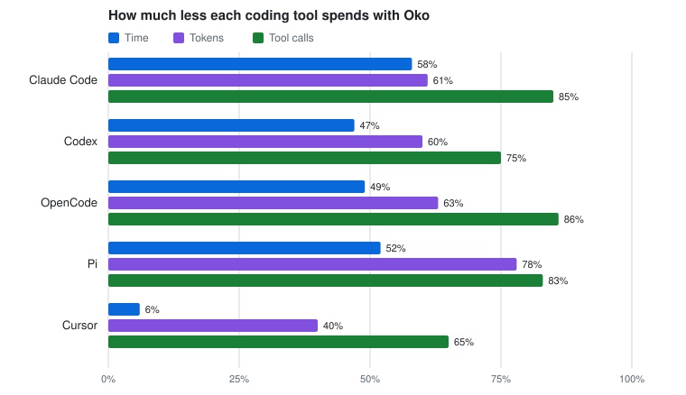

<p align="center">
  
</p>

<h1 align="center">Oko</h1>

<p align="center">
  <strong>Help your coding agent find code faster and use fewer tokens.</strong>
</p>

<p align="center">
  <a href="https://github.com/bartlomein/oko/actions/workflows/ci.yml"></a>
  <a href="https://github.com/bartlomein/oko/releases/latest"></a>
  <a href="LICENSE"></a>
</p>

Oko gives Claude Code, Codex, Cursor, OpenCode and Pi a better code search. When
you ask your agent about your code, Oko has already found the relevant source,
so the agent spends fewer rounds searching and reading files it does not need.

<p align="center">
  <picture>
    <source media="(prefers-color-scheme: dark)" srcset="docs/images/agent-sessions-dark.svg">
    <source media="(prefers-color-scheme: light)" srcset="docs/images/agent-sessions-light.svg">
    
  </picture>
  <br>
  <sub>Nine coding tasks on Astro, HTTPX and ripgrep, three runs each, with and without Oko. <a href="#results">Results</a> · <a href="docs/benchmark-results.md#agent-sessions">Method</a></sub>
</p>

- **Faster:** about half the time in Claude Code, OpenCode and Pi; a quarter less in Codex.
- **Cheaper:** 33–44% fewer tokens with every tool we measured.
- **Fewer detours:** 65–89% fewer tool calls.
- **Better ranking:** puts the right file first more often than any published method on [Agent Retrieval Bench](#other-benchmarks).
- **Local first:** search runs on your machine; only the question and selected snippets go to the ranker ([privacy](docs/privacy.md)).

## Quick start

```sh
brew install bartlomein/tap/oko
cd your-project
oko setup --client claude     # or codex, cursor, opencode, pi, all
```

Without Homebrew: `curl -fsSL https://raw.githubusercontent.com/bartlomein/oko/main/install.sh | sh`.

Then use your coding tool as usual. Setup asks for a [TypeSafe AI](https://typesafe.ai/)
key the first time, connects your tool to Oko for this project, and checks the
connection. Run it once per project; `oko upgrade` keeps everything current
(with Homebrew, run `brew upgrade oko` first).

<details>
<summary><strong>Codex:</strong> approve Oko's hook once</summary>

The first time you open the project, Codex shows **Hooks need review**. Choose
**Trust all and continue**. If you skipped it, `/hooks` brings it back.
</details>

<details>
<summary><strong>Cursor:</strong> turn Oko on once</summary>

Cursor adds a project's tools switched off. Open **Customize > MCPs**, click
**oko** and turn it on.
</details>

<details>
<summary><strong>Pi:</strong> trust the project</summary>

Pi 1.0 or later. Trust the project when Pi asks, then check `/mcp`.
[Pi setup](docs/clients.md#pi-10-by-hand).
</details>

<details>
<summary><strong>Claude Code, OpenCode:</strong> nothing more to do</summary>

Start a new session after setup.
</details>

<details>
<summary>Platforms, manual install, no-key mode</summary>

macOS (Apple Silicon and Intel) and Linux (ARM64 and x64, glibc 2.35+). The
installer puts `oko` in `~/.local/bin`; add it to your `PATH` if needed.
[Other install options](docs/installation.md) · [Connect a tool by hand](docs/clients.md) ·
[Keys and configuration](docs/configuration.md). For search without a key,
add `--no-jev`: local keyword ranking only.
</details>

## Results

The same task given to the same coding tool twice, once with its own search and
once with Oko, in the same run. Means per session.

| Coding tool | Time | Tokens | Tool calls | Tasks passed (without → with) |
| --- | --- | --- | --- | --- |
| Claude Code | **47% less**<br><sub>12.1 → 6.4 s</sub> | **44% less**<br><sub>24,271 → 13,627</sub> | **89% less**<br><sub>3.5 → 0.4</sub> | 19 → 20 of 20 |
| Codex | **26% less**<br><sub>13.8 → 10.2 s</sub> | **43% less**<br><sub>45,395 → 26,004</sub> | **80% less**<br><sub>3.0 → 0.6</sub> | 20 → 20 of 20 |
| OpenCode | **47% less**<br><sub>18.0 → 9.6 s</sub> | **43% less**<br><sub>13,196 → 7,528</sub> | **87% less**<br><sub>3.7 → 0.5</sub> | 21 → 21 of 21 |
| Pi | **51% less**<br><sub>16.7 → 8.2 s</sub> | **33% less**<br><sub>9,737 → 6,495</sub> | **85% less**<br><sub>3.6 → 0.5</sub> | 20 → 21 of 21 |
| Cursor | **6% less**<br><sub>52.3 → 49.2 s</sub> | **40% less**<br><sub>182,940 → 109,520</sub> | **65% less**<br><sub>8.0 → 2.8</sub> | 26 → 24 of 27 |

<sub>Models: Claude Sonnet 5.5 (Claude Code), GPT-6.1 Sol (Codex, OpenCode, Pi), Grok 4.7 High (Cursor), at their default or low effort. Cursor's row is from its own run on the previous release; the others are from October 2026. Each tool counts tokens its own way, so compare within a row. Small benchmark; your results will vary. [Method, per-task results and caveats](docs/benchmark-results.md#agent-sessions) · [raw data](benchmarks/published/).</sub>

## Other benchmarks

| Benchmark | What it tests | Oko | Best comparison |
| --- | --- | --- | --- |
| [Sense's agent benchmark](docs/benchmark-results.md#senses-agent-benchmark-against-sense) | Six multi-step tasks, Claude Opus 4.7, run against Sense the same evening | Found **88%** of the locations to cite, at **half the cost** | Sense: 63% |
| [Agent Retrieval Bench](docs/benchmark-results.md#agent-retrieval-bench) | 345 tasks: find the files a developer needs next | Right file ranked first most often: **0.37** | Best published method: 0.24 |
| [SWE-Explore](docs/benchmark-results.md#swe-explore) | 848 real issues: rank the code fixing agents needed | One search ranks it within the range of agents that explore for many turns: **0.82** | Agents: 0.72–0.95 |

## Where Oko helps less

- **Cursor's own search is already fast,** so Oko saves less time there: mostly tokens and tool calls.
- **Duplicated code can mislead it.** When two files hold identical copies of a function, Oko may show the wrong one first; one Astro edit task in our benchmark fails this way.
- **Big changes across many files:** one search returns five places, so an issue touching many files still needs the agent's own exploring.

## Use it from your terminal

```sh
oko ask "where is authentication handled?"
oko ask "how are retries handled?" --json
oko stats                     # what ranking has cost you
```

More in [search options](docs/search.md).

## How it works

Oko searches your project locally (keywords, symbols and file structure), then
asks [Jev](https://typesafe.ai/), TypeSafe AI's relevance model, which of the
candidates actually answer the question, and returns those excerpts with exact
line numbers. `oko setup` connects it to your tool as an MCP server, adds short
guidance to the instructions your tool reads, and installs a hook that answers a
code question as you send it.
[What setup changes](docs/mcp.md#set-up-a-project) · [Privacy](docs/privacy.md).

## Documentation

| I want to… | Guide |
| --- | --- |
| Install, upgrade or troubleshoot | [Installation](docs/installation.md) |
| Connect a tool by hand, or understand the MCP tool | [Client setup](docs/clients.md) · [MCP reference](docs/mcp.md) |
| Configure keys, `.env` or caching | [Configuration](docs/configuration.md) |
| Search from the terminal, or rank my own documents | [Search](docs/search.md) · [Document ranking](docs/ranking.md) |
| See every benchmark and how it was run | [Benchmark results](docs/benchmark-results.md) |
| Know what leaves my machine | [Privacy](docs/privacy.md) |

## Contributing

Bug reports and ideas are welcome: [open an issue](https://github.com/bartlomein/oko/issues)
with your OS and `oko --version`, without keys or private code. To build and
test, see [CONTRIBUTING.md](CONTRIBUTING.md).

## License

[MIT](LICENSE). Dependency attributions are in [THIRD_PARTY_NOTICES.md](THIRD_PARTY_NOTICES.md).
